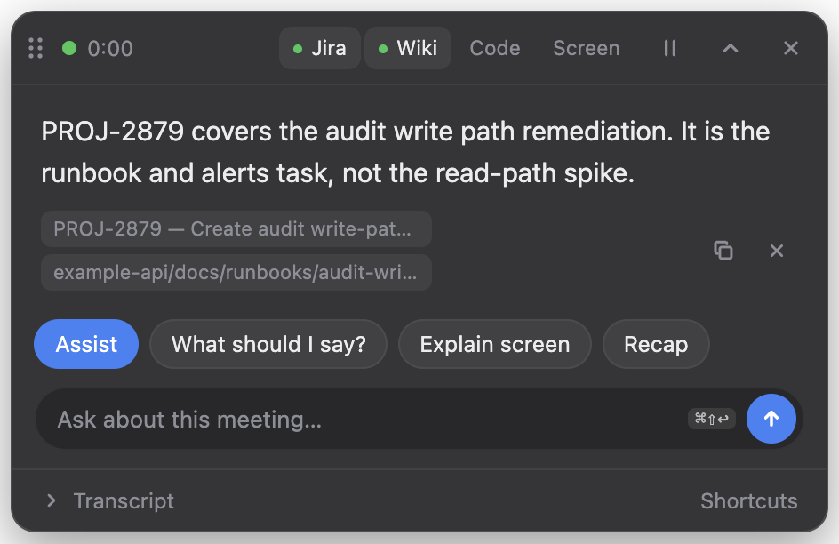
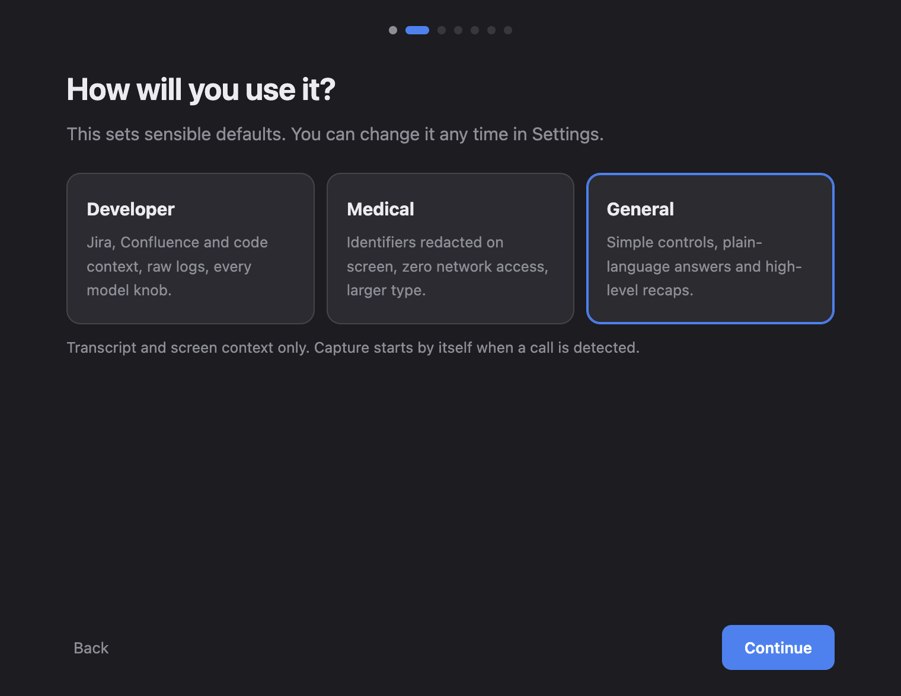

# Clueless

**A meeting assistant that runs entirely on your Mac.** Clueless listens to your
calls, transcribes them on-device, and answers questions about the conversation
on a hotkey. Nothing is uploaded, and the overlay is invisible to screen share.

<p align="center">
  
</p>

- **Ask on a hotkey.** `⌘⇧\` answers from the last 90 seconds of conversation.
  `⌘⇧A` suggests what to say next, and `⌘⇧E` explains what was just said.
- **Works with any call app.** Teams, Zoom, Webex, FaceTime and Skype. It hears
  both sides: your microphone, and the other people through system audio.
- **Local models only.** Use Ollama, llama.cpp, LM Studio, a GGUF file, or Apple
  Intelligence. Every provider URL must be on this machine.
- **Built for your field.** Developer, Medical and General profiles change the
  sources, prompts, privacy defaults and layout.

## Privacy, verified

| Claim | How it is enforced |
|---|---|
| Audio and transcripts stay on the Mac | Speech recognition is Apple's on-device Speech framework; transcripts live in memory and are never written to disk |
| Prompts never leave the Mac | Every model request goes through one HTTP helper that refuses non-loopback URLs ([details](docs/privacy.md)) |
| Web pages can't read your meeting | The local API needs a per-launch token, rejects browser `Origin`s and non-loopback `Host`s ([security model](SECURITY.md)) |
| Others on the call can't see it | The overlay window is excluded from screen capture |
| Medical mode makes no network requests | Jira, Confluence and GitHub indexing are disabled outright, and identifiers are redacted on screen |

A runtime audit during a live session showed only loopback connections. See
[docs/privacy.md](docs/privacy.md) for the method.

## Requirements

- **macOS 26 (Tahoe) or later on Apple silicon.** On-device transcription
  needs the macOS 26 Speech framework, and the helpers are arm64-only.
- **16 GB of memory recommended.** 8 GB works with a 3B model.
- **A local model:** [Ollama](https://ollama.com) with `llama3.1:8b`, a llama.cpp
  server, LM Studio, or a `.gguf` file. Apple Intelligence works as a fallback.

Clueless checks all of this at launch and tells you what is missing.

## Install

1. Download `Clueless-<version>-arm64.dmg` from the [latest release](../../releases/latest)
   and drag **Clueless** into **Applications**.
2. Open it. Releases aren't notarized yet, so the first launch is blocked with
   *"Apple could not verify Clueless is free of malware"*. Choose **Done**,
   then open **System Settings → Privacy & Security**, scroll to Security, and
   choose **Open Anyway** next to Clueless. Since macOS 15, right-click → Open
   no longer bypasses this. Alternatively, after checking the download's
   checksum:
   ```bash
   xattr -dr com.apple.quarantine /Applications/Clueless.app
   ```
3. The walkthrough covers consent, picking a profile, a system check, audio
   permissions, choosing a model, and a short test.

Verify a download with the `SHA256SUMS.txt` file attached to every release:
`shasum -a 256 -c SHA256SUMS.txt`.

<p align="center">
  
</p>

## Quick start

| Hotkey | Action |
|---|---|
| `⌘⇧\` | Answer from the last 90 seconds |
| `⌘⇧A` | What should I say? |
| `⌘⇧E` | Explain what was just said |
| `⌘⇧↩` | Type a question |
| `⌘⇧S` | Summarise the meeting |
| `⌘⇧H` | Collapse, hide or show the overlay |
| `⌘⌥4` | Toggle screen context |
| `⌘⌥1`–`3` | Toggle Jira, Wiki and Code context (Developer profile) |

The menu bar icon (`◉` listening, `⏸` paused, `○` idle) has pause, settings and
**Run walkthrough again…**.

## Profiles

| | Developer | Medical | General |
|---|---|---|---|
| Context sources | Jira, Confluence, code, screen | Transcript and screen | Transcript and screen |
| Network access | Only when you index | **None** | Only when you index |
| Identifier redaction | Off | **On** | Off |
| Summary | Summary, decisions, action items, open questions | Clinical: no invented dosages or diagnoses | What happened, decisions, next steps |
| Interface | Logs and advanced tuning | Larger type, high contrast, no transcript panel | Simple controls |

The Medical profile is **HIPAA-aware, not HIPAA-certified**. See
[docs/personas.md](docs/personas.md) for what it does and does not do.

## Models

Clueless finds a running local model server and uses the best model it can.
If the configured model is missing, it falls back to the largest one that fits
in memory. If no server is running, it uses Apple Intelligence and the overlay
warns that answers are less reliable. Details, including offline GGUF import,
are in [docs/providers-and-models.md](docs/providers-and-models.md).

## Build from source

```bash
git clone <this repo> && cd clueless
cd native && ./setup-signing.sh && ./build.sh && cd ..
python3 -m pip install -r requirements.txt
cd overlay && npm ci && npm run start:ls
```

[docs/getting-started.md](docs/getting-started.md) covers this in full.
[docs/building-and-releasing.md](docs/building-and-releasing.md) covers building
the DMG and the release pipeline.

## Documentation

- [Getting started from source](docs/getting-started.md)
- [Profiles](docs/personas.md)
- [Providers and models](docs/providers-and-models.md)
- [Permissions](docs/permissions.md): why macOS asks twice, and how the audio paths work
- [Privacy](docs/privacy.md)
- [Troubleshooting](docs/troubleshooting.md)
- [Architecture](docs/architecture.md)
- [Building and releasing](docs/building-and-releasing.md)

## FAQ

**Is recording my meetings legal?** That depends on where you and the other
participants are. Many places require everyone's consent. Tell people you use a
transcription assistant, and follow your organisation's policy. Running locally
protects the data; it does not replace consent.

**Does it work offline?** Yes, once a model is on disk. Speech assets download
from Apple the first time you use a language.

**Why not Whisper?** Apple's on-device recognizer streams cleanly, needs no
model download, and runs about 15× faster than real time. Whisper weights come
from Hugging Face, which some networks block.

**Intel Mac or macOS 15?** Not supported. The process-tap and on-device speech
APIs this relies on are macOS 26 and Apple silicon only.

## Contributing

Contributions are welcome. Start with [CONTRIBUTING.md](CONTRIBUTING.md), and
report vulnerabilities privately as described in [SECURITY.md](SECURITY.md).
This project follows the [Contributor Covenant](CODE_OF_CONDUCT.md).

## License

[MIT](LICENSE). Third-party licenses are listed in `THIRD_PARTY_NOTICES.txt`,
which ships inside the app.
