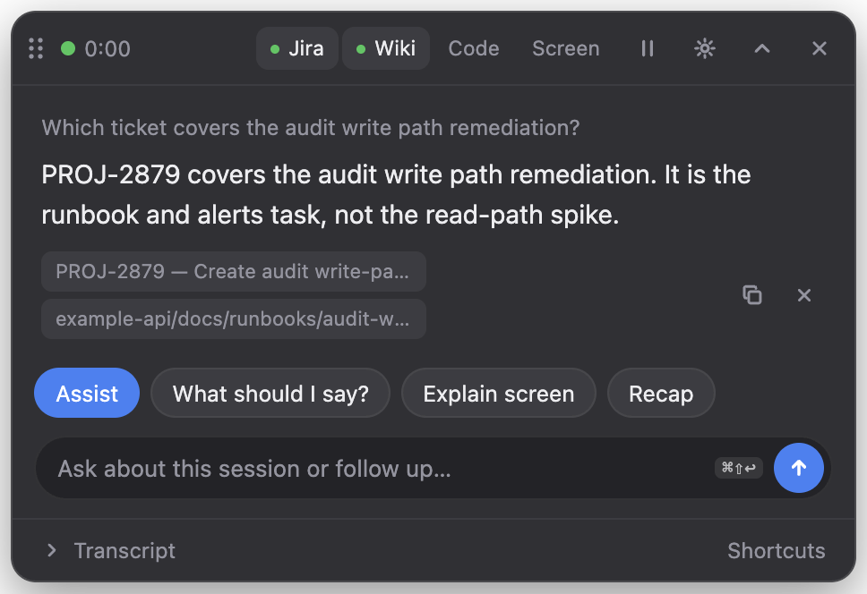
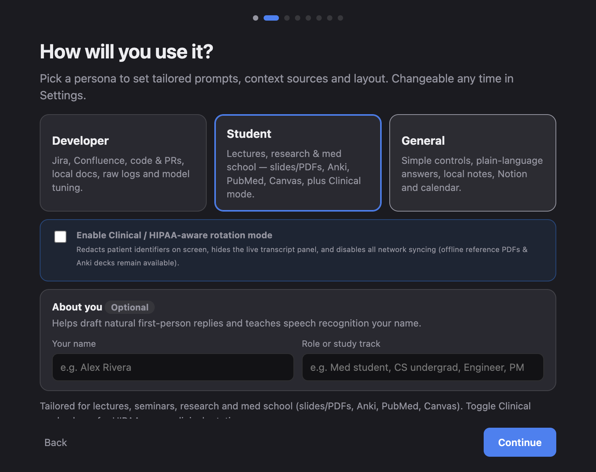

# Clueless

<p align="center">
  
</p>

**A meeting and study assistant that runs entirely on your Mac.** Clueless listens to
your calls or lectures, transcribes them on-device, and answers questions about
the conversation on a hotkey. Nothing is uploaded, and the overlay is excluded
from screen share. The project site is
[jadenbanze.github.io/clueless](https://jadenbanze.github.io/clueless/).

<p align="center">
  
</p>

- **Ask on a hotkey.** `⌘⇧\` answers from the last 90 seconds. `⌘⇧A` drafts what
  to say next in your voice, `⌘⇧E` captures and explains what is on your screen,
  and `⌘⇧S` streams a structured recap.
- **Works with any call or lecture.** Teams, Zoom, Webex, FaceTime and Skype. It
  hears both sides — your microphone (with speaker-bleed deduplication) and
  everyone else through macOS system audio.
- **Local models & hybrid search.** Use Ollama, llama.cpp, LM Studio, a `.gguf`
  file, or Apple Intelligence. Hybrid SQLite FTS5 (BM25) + vector retrieval keeps
  local search working even when no embedding server is running.
- **Built for developers, students, clinicians and everyday calls.** Choose
  **Developer**, **Student** (with an inline **Clinical / HIPAA-aware** rotation
  mode), or **General** in the setup wizard or live from the overlay toolbar's
  Settings gear.

## Privacy, verified

| Claim | How it is enforced |
|---|---|
| Audio and transcripts stay on the Mac | Speech recognition uses Apple's on-device Speech framework; transcripts live in memory only and are never written to disk |
| Prompts never leave the Mac | Every model request goes through one HTTP helper that refuses non-loopback URLs ([details](docs/privacy.md)) |
| Web pages can't read your session | The local API requires a per-launch token and rejects browser `Origin`s and non-loopback `Host`s ([security model](SECURITY.md)) |
| Others on the call don't see it | The overlay window is excluded from screen capture via `setContentProtection(true)` |
| Clinical mode makes zero network calls | Enabling Clinical mode under Student disables outbound indexers in code (`NETWORK_INDEXING = False`) and redacts patient identifiers on screen |

A runtime audit during a live session showed only loopback connections. See
[docs/privacy.md](docs/privacy.md) for the method.

## Requirements

- **macOS 26 (Tahoe) or later on Apple silicon.** On-device transcription,
  PDFKit extraction and EventKit calendar context use macOS 26 frameworks on
  arm64.
- **16 GB of memory recommended.** 8 GB works with a 3B model.
- **A local model:** [Ollama](https://ollama.com) with `llama3.1:8b`, a
  `llama.cpp` server, LM Studio, or a `.gguf` file. Apple Intelligence works as
  an on-device fallback.

Clueless checks all of this at launch and walks you through setup on first run.

## Install

1. Download `Clueless-<version>-arm64.dmg` from the
   [latest release](../../releases/latest) and drag **Clueless** into
   **Applications**.
2. Open it. Releases aren't notarized yet, so the first launch is blocked with
   *"Apple could not verify Clueless is free of malware"*. Choose **Done**,
   then open **System Settings → Privacy & Security**, scroll to Security, and
   choose **Open Anyway** next to Clueless (or after verifying `SHA256SUMS.txt`:
   `xattr -dr com.apple.quarantine /Applications/Clueless.app`).
3. Complete the step-by-step wizard: consent, persona (**Developer**,
   **Student** / **Clinical**, or **General**), optional **About you** role
   context, permissions, context folders/sources, local model selection, and a
   live microphone check.

Verify any release download with `shasum -a 256 -c SHA256SUMS.txt`.

<p align="center">
  
</p>

## Quick start

| Hotkey | Action |
|---|---|
| `⌘⇧\` | Answer from the last 90 seconds |
| `⌘⇧A` | What should I say? (first-person reply) |
| `⌘⇧E` | Capture & explain what is on your active screen |
| `⌘⇧↩` | Type a question or follow up on the current answer |
| `⌘⇧S` | Stream a recap of the session |
| `⌘⌥1`–`4` | Toggle your active persona's context sources |
| `⌘⇧H` | Collapse, hide or show the overlay |
| `⌘,` | Open Settings (also one click via the overlay toolbar gear `⚙` or menu bar `◉`) |

Answers keep an in-session history (`‹ 1/3 ›`), and clicking a citation opens
its Jira ticket, Wiki page, GitHub file/PR, PubMed paper, Canvas item, Notion
page, or local file in Finder (`⌥`-click copies the citation).

## Personas & Context Sources

Switch personas or sync sources live in **Settings → General & Profile** and
**Settings → Context Sources** without restarting or losing an active transcript.

| | Developer | Student *(standard)* | Student *(Clinical mode)* | General |
|---|---|---|---|---|
| **Built-in sources** | Jira (comments & blockers), Confluence, GitHub code & PRs, Local files, Calendar, Screen | Local PDFs/PPTX/DOCX/MD, Anki (`.apkg` / Anki2), PubMed + Zotero (`.bib`/`.ris`), Canvas LMS, Notion, Calendar, Screen | **Offline-only** Local PDFs/guidelines, offline Anki decks, Screen | Local notes/files, Notion, Calendar, Screen |
| **Default `⌘⌥1–4`** | Jira · Wiki · Code · Screen | Notes · Anki · Papers · Screen | Notes · Anki · Screen | Notes · Notion · Cal · Screen |
| **Network syncing** | Only when you click Sync | Only when you click Sync | **Disabled in code** | Only when you click Sync |
| **Identifier redaction** | Optional | Optional | **Locked on** | Optional |
| **Summary format** | Summary, Decisions, Action items, Open questions | Overview, Key takeaways, Action items, Questions to review | Clinical (no invented dosages/diagnoses; refers to "the patient") | What happened, Decisions, Next steps |

Clinical mode is **HIPAA-aware, not HIPAA-certified**. See
[docs/personas.md](docs/personas.md) for full details.

## Models

Clueless auto-detects running local model servers and picks the best model that
fits in memory. If no server is running, it falls back to Apple Intelligence on
the Neural Engine and notes the degraded mode in the toolbar. Offline `.gguf`
import and tuning details live in
[docs/providers-and-models.md](docs/providers-and-models.md).

## Build from source

```bash
git clone https://github.com/jadenbanze/clueless.git && cd clueless
cd native && ./setup-signing.sh && ./build.sh && cd ..
python3 -m pip install -r requirements.txt
cd overlay && npm ci && npm run start:ls
```

See [docs/getting-started.md](docs/getting-started.md) and
[docs/building-and-releasing.md](docs/building-and-releasing.md) for packaging
and signing details.

## Documentation

- [Getting started from source](docs/getting-started.md)
- [Personas & Clinical mode](docs/personas.md)
- [Providers and models](docs/providers-and-models.md)
- [Permissions](docs/permissions.md): why macOS asks twice, and how the audio paths work
- [Privacy](docs/privacy.md)
- [Troubleshooting](docs/troubleshooting.md)
- [Architecture](docs/architecture.md)
- [Building and releasing](docs/building-and-releasing.md)

## Contributing & Security

Contributions are welcome — see [CONTRIBUTING.md](CONTRIBUTING.md),
[CODE_OF_CONDUCT.md](CODE_OF_CONDUCT.md), and private vulnerability reporting in
[SECURITY.md](SECURITY.md).

## License

[MIT](LICENSE). Third-party notices ship in `THIRD_PARTY_NOTICES.txt`.
