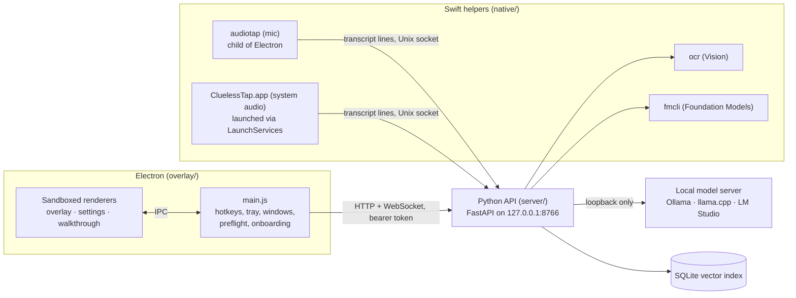

# Architecture

Clueless is three processes plus a model server, all on one Mac, talking over
loopback.

## Data flow for one question

1. **Capture.** Each helper captures one stream: the mic through Core Audio, or
   other apps through a process tap. It drops buffers below an adaptive noise
   floor, and transcribes the rest on-device with `SpeechAnalyzer` and
   `SpeechTranscriber`.
2. **Transcript.** The helpers send finalized lines (`me` or `them`) to the API
   over a Unix socket. Raw audio never leaves the helper. The API applies
   vocabulary corrections and keeps a rolling in-memory window of turns.
3. **Hotkey.** `⌘⇧\` makes Electron call `POST /ask`, which returns
   immediately.
4. **Context.** The API gathers the context for the answer:
   - the recent transcript;
   - retrieved Jira, Confluence or code chunks, for the sources that are
     switched on (`rag.py`, with vector search plus a small lexical boost);
   - OCR'd screen text, if screen context is on.
5. **Prompt.** The question goes first, then the transcript, then the
   retrieved context (`brain.py`). Each section is truncated against fixed
   budgets.
6. **Generate.** `providers/` resolves which backend to use and streams
   tokens. Each delta goes over the WebSocket as `answer_delta`. In the Medical
   profile, the delta carries the *whole redacted answer so far*.
7. **Display.** The renderer shows the deltas as they arrive.

## Directory map

| Path | Contents |
|---|---|
| `native/` | Swift sources for the helpers and `build.sh`. `main.swift` + `speech.swift` make up the audio tap |
| `server/api.py` | HTTP routes, the WebSocket, and session state |
| `server/security.py` | API token, Origin and Host checks |
| `server/providers/` | Model backends, the fallback ladder, and the loopback-only HTTP helper |
| `server/brain.py` | Prompt assembly and answer clean-up |
| `server/profiles.py` | Persona definitions |
| `server/phi.py` | Identifier redaction |
| `server/indexers.py`, `rag.py`, `vectorstore.py` | Jira, Confluence and GitHub indexing; retrieval over SQLite + numpy |
| `server/settings_schema.py` | Validation for everything the settings window can write |
| `overlay/main.js` | Electron main process |
| `overlay/preflight.js` | Launch-time system check (plain Node, unit-tested) |
| `overlay/tokens.css` | Design tokens and persona overrides |
| `overlay/{index,settings,onboarding,requirements}.html` | Windows, each with its own preload |

## Security boundaries

- **Renderers** are sandboxed, use context isolation, and have no Node
  integration. Each has a strict CSP. Navigation and new windows are blocked.
  The preload exposes only named IPC calls, and the main process checks which
  window each call came from.
- **The API** needs a per-launch bearer token. Electron generates it and passes
  it in the environment, never in argv. The API rejects browser `Origin`s and
  non-loopback `Host` headers.
- **Model egress** goes through a single function (`providers/http.py:_open`)
  that refuses non-loopback URLs. The linter flags any other `urlopen`.
- **Medical mode** disables the indexers in code and redacts at the API
  boundary, so nothing unredacted reaches a renderer.

## Design decisions worth knowing

These were measured, and they are easy to undo by accident:

- **Two helpers, not one.** The mic and system audio need different responsible
  processes for macOS permissions ([permissions.md](permissions.md)).
- **`SpeechTranscriber` with the `.transcription` preset.** Dictation presets
  were more accurate on finished files, but they don't stream cleanly. They
  emit nothing until finalized, or restate partial phrases over and over.
- **Hotkey only.** No automatic question detection, which would be the
  flakiest component.
- **Sources toggled by the user, not gated by relevance.** Similarity scores
  don't separate relevant from irrelevant here; a question about baking bread
  scored 0.6 against real code.
- **Question before transcript in the prompt.** With the question last, small
  models answered the most recent utterance instead.
- **No examples in prompts.** Small models copy them into answers verbatim.
