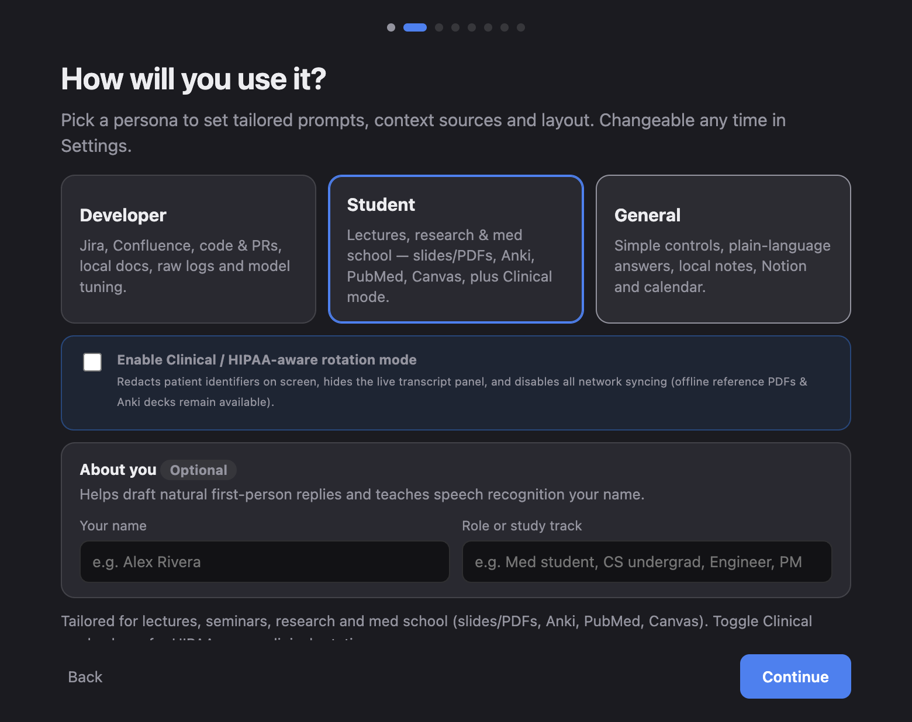
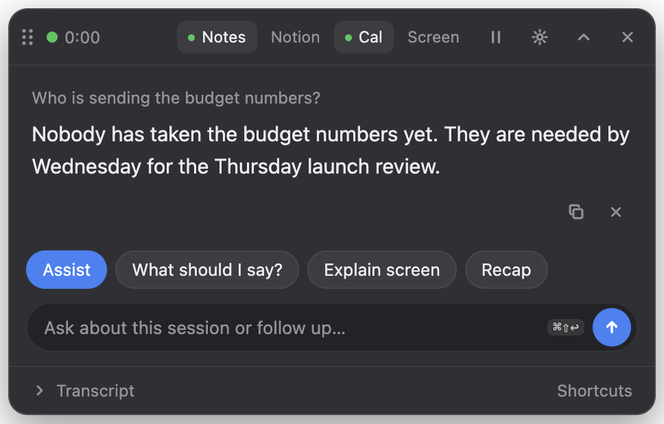

# Profiles

A profile is a set of defaults for one kind of work or study. Choose it in the
setup wizard or in **Settings → General & Profile** — changes apply live without
restarting or losing your current transcript.

## Developer

For engineering meetings, standups, architecture reviews and incident calls.

- **Sources:** Jira, Confluence, Local files, and Calendar are available out of
  the box; GitHub code & Pull Requests and Screen OCR are one keystroke away
  (`⌘⌥3`, `⌘⌥4`). Code starts off so unrelated source files don't distract
  high-level planning calls.
- **Prompt:** prefers exact identifiers, ticket keys, PR numbers, file paths and
  commands when the sources contain them, and never invents one.
- **Summary:** Summary, Decisions, Action items (`owner — action`), and Open
  questions.
- **Settings:** adds the Advanced (context size, answer length, temperature) and
  Logs tabs.

## Student (with Clinical Rotation Mode)

For university lectures, seminars, research groups and medical school.

- **Sources:** Local study files (`.pdf` slides/textbooks via macOS PDFKit,
  `.pptx`, `.docx`, Obsidian `.md`), offline **Anki** decks (`.apkg` or live
  Anki2 collections), **PubMed** literature & **Zotero** bibliographies (`.bib`
  / `.ris`), **Canvas LMS** courses/syllabi/assignments, **Notion**, **Calendar**
  and **Screen OCR**.
- **Prompt:** explains concepts clearly using exact terminology, mechanisms or
  study findings from your lecture and reference material; never invents
  citations, dosages or facts.
- **Summary:** Overview, Key takeaways, Action items, and Questions to review.

### Clinical / HIPAA-aware Sub-mode

Enable **Clinical / HIPAA-aware rotation mode** inside the Student profile (in
either the setup wizard or **Settings → General & Profile**) for clinical
encounters, handovers and case discussions.

> **HIPAA-aware, not HIPAA-certified.** Clueless runs entirely on your Mac, and
> Clinical mode restricts what is shown and blocks outbound network syncing. It
> is not a certified medical device, and nobody signs a Business Associate
> Agreement for it. Consent and institutional policies remain your responsibility.

What Clinical mode enforces:

- **Zero outbound network indexing.** PubMed, Canvas, Notion, Jira, Confluence
  and GitHub indexers are disabled in code (`NETWORK_INDEXING = False`). Offline
  local reference PDFs/guidelines and offline Anki decks on disk remain usable.
- **Identifier redaction.** Everything shown, streamed, copied or exported passes
  through `server/phi.py` before leaving the API (names after titles or
  "patient", dates/DOBs, MRNs, phone numbers, emails, addresses and SSNs).
- **Safe streaming.** Redacted answers hold back unfinished trailing words so
  multi-token names never leak mid-stream.
- **Clinical summary & interface:** larger type, higher contrast, hidden live
  transcript panel, and clinical summary rules that forbid invented dosages or
  diagnoses and refer to `"the patient"`.

## General

For everyday meetings: one-to-ones, interviews, planning and client calls.

- **Sources:** Local notes/files, Notion, macOS Calendar, and Screen OCR.
- **Prompt:** one or two plain sentences, without jargon.
- **Summary:** What happened, Decisions, and Next steps.
- **Capture:** starts automatically when a call app plays call audio, and stops
  after the call ends.

