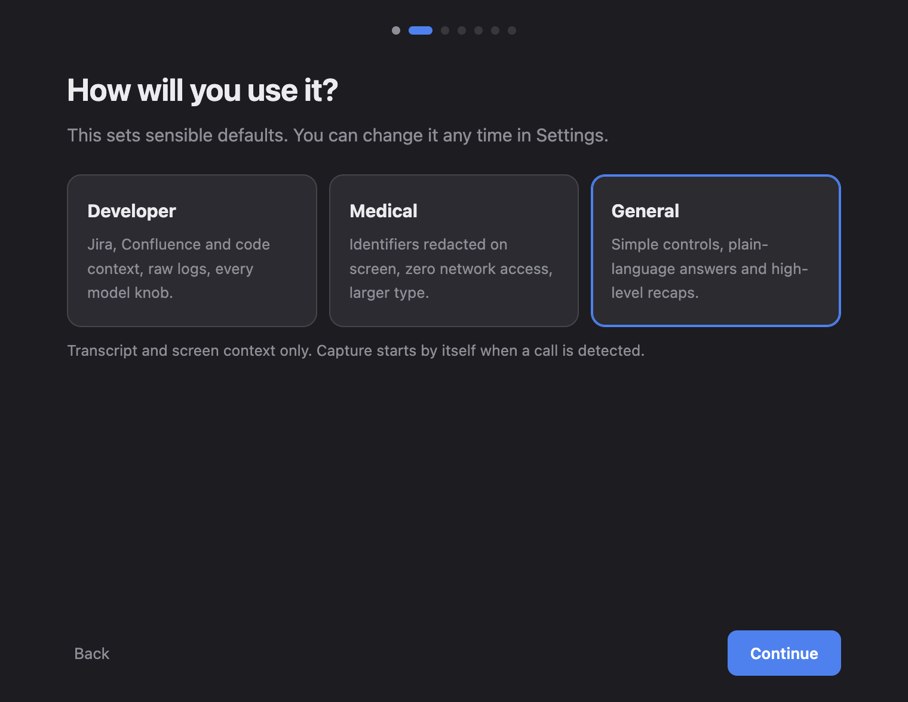
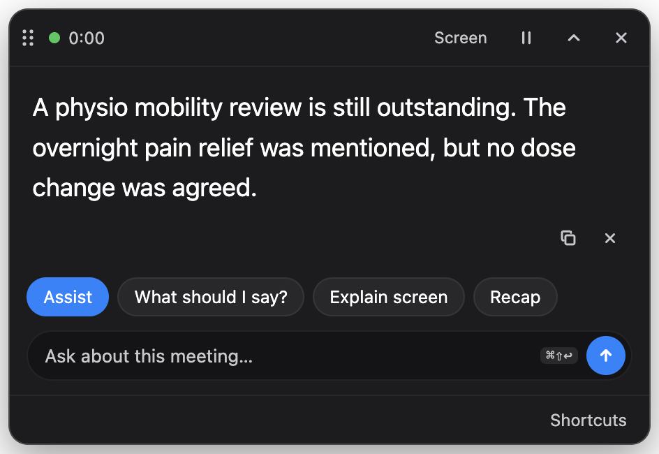
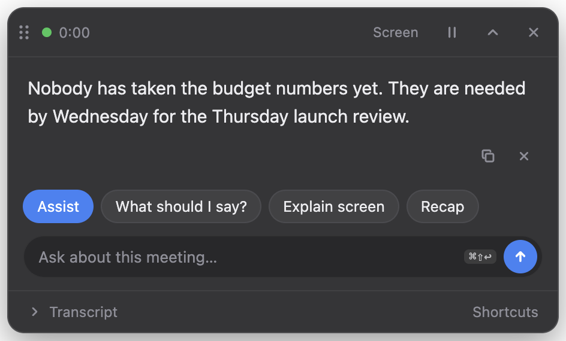

# Profiles

A profile is a set of defaults for one kind of work. Choose it in the walkthrough
or in **Settings → General**, then restart. Every setting a profile changes can
still be changed on its own, with one exception: Medical's network restriction
can't be turned off from the UI.

## Developer

For meetings about tickets and code.

- **Sources:** Jira and Confluence are on by default. Code and screen context
  are one keystroke away (`⌘⌥3`, `⌘⌥4`). Code starts off because in a meeting
  that isn't about the codebase, retrieved source files mislead the model.
- **Prompt:** prefers exact identifiers, such as ticket keys, file paths and
  commands, when the sources contain them, and never invents one.
- **Summary:** Summary, Decisions, Action items (`owner — action`), and Open
  questions.
- **Settings:** adds the Work sources, Advanced (context size, answer length,
  temperature) and Logs tabs.

## Medical

For clinical meetings, handovers and case discussions.

> **HIPAA-aware, not HIPAA-certified.** Clueless runs entirely on your Mac, and
> this profile reduces what is shown and what can leave the machine. It is not a
> certified product, and nobody signs a Business Associate Agreement for it.
> Consent, record-keeping and your organisation's policies remain your
> responsibility.

What it does:

- **No network access.** Jira, Confluence and GitHub indexing are disabled in
  code, not just switched off by default. The indexers refuse to run, and the
  setting can't be changed from the UI.
- **Identifier redaction.** Everything shown, streamed, copied or exported
  passes through a redactor before it leaves the API. That covers names after
  titles (Dr, Nurse) and after "patient", dates and dates of birth, record
  numbers, phone numbers, emails, street addresses and SSNs.
- **Answers stream without leaking.** A name split across two streamed
  fragments can't be redacted one fragment at a time. So the overlay receives
  the whole redacted answer so far, minus the last unfinished word.
- **Prompt:** plain clinical language. It never guesses a dosage, diagnosis,
  lab value or patient detail that was not said.
- **Summary:** clinical format. It refers to "the patient" rather than
  repeating identifiers.
- **Interface:** larger type, higher contrast, and no transcript panel. The
  transcript is still captured so questions can be answered; it just isn't
  displayed.

What it does **not** do:

- It does not redact the audio, or the transcript held in memory for answering
  questions. Both stay on the Mac and are never written to disk.
- Redaction is pattern-based. It is tested against common forms
  (`server/test_phi.py`), but it will miss unusual ones, such as a surname
  spoken with no title. Treat it as a second line of defence, not a guarantee.
- It does not stop you sharing your own screen while the overlay is visible to
  you. The overlay itself is excluded from screen capture.

## General

For everyone else: one-to-ones, interviews, planning, lectures.

- **Sources:** transcript and screen only. The work-source controls are hidden.
- **Prompt:** one or two plain sentences, without jargon.
- **Summary:** What happened, Decisions, and Next steps.
- **Capture:** starts by itself when a call app is playing call audio, and stops
  a few minutes after the call ends.

## Adding a profile

Profiles live in `server/profiles.py`. A profile is:

- some flags: `developer_mode`, `network_indexing`, `redact_phi`
- one prompt line, appended to the shared rules
- a summary prompt
- a `ui` block: `font_scale`, `show_transcript`, and so on

Persona styles hang off `[data-profile]` in `overlay/tokens.css`.

Add assertions for any guarantee the profile makes to `server/test_profiles.py`.
Run `test_brain` with `PROFILE=<name>` before opening a PR.
