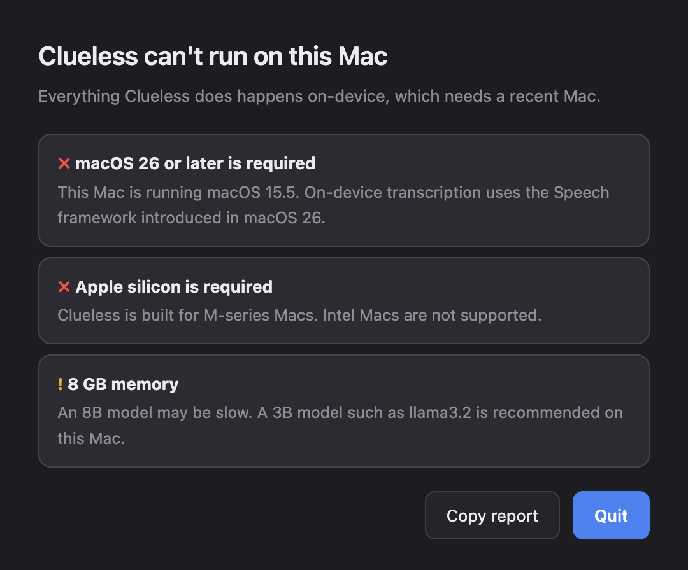

# Troubleshooting

Start with the warning icon on the overlay, which names the problem it detected.
Logs are in `~/Library/Application Support/Clueless/logs/` (installed) or
`logs/` (from source). Developer-profile users can also open them in
**Settings → Logs**.

| Log | Contents |
|---|---|
| `api.log` | API requests, timings, provider selection |
| `mic-helper.log` | Microphone capture and transcription |
| `system-helper.log` | System audio capture and transcription |
| `api-stdout.log` | Python start-up errors |
| `llama-server.log` | Managed llama.cpp server, if used |

## "This Mac can't run Clueless"

The launch check found something that can't be worked around: macOS older than
26, an Intel Mac, or less than 2 GB of free disk. **Copy report** puts the
details on the clipboard for an issue.



## The app seems to hang on launch

Keep Clueless in **/Applications**. macOS protects Desktop, Documents and
Downloads, so an app started from one of them asks *"Clueless would like to
access files in your Desktop folder"*. Until that prompt is answered, which may
be behind other windows, the app is blocked before it starts.

## `⌘⌥1`–`⌘⌥3` do nothing

The Jira, Wiki and Code toggles exist only in the Developer profile. Switch
profiles in **Settings → General**.

## Port 8766 is already in use

Another copy of Clueless is still running. Quit it from the menu bar, or, from
source, run `npm run stop` in `overlay/`.

## No transcript for the other people on the call

1. Open **Run walkthrough again…** from the menu bar, go to Permissions, and
   choose **Test system audio**. A flat meter means permission was denied.
2. In **System Settings → Privacy & Security → System Audio Recording**, make
   sure *Clueless* or *CluelessTap* is on.
3. Running from source? Start with `npm run start:ls`, not `npm start`. See
   [permissions.md](permissions.md).
4. Check `system-helper.log`. `SILENT` means the tap is working but receiving
   zeros, which is almost always a permission problem.

## No transcript for me

- Check **Microphone** permission, and the input device in **System Settings →
  Sound**.
- The microphone sends no audio at all in true silence. A log with no
  `buffers=` lines means no sound reached the helper.
- Quiet speech can fall under the noise gate. `gated=` counts the buffers
  rejected as background noise.

## The transcript shows words nobody said

Speech recognisers produce phrases from low-level noise, such as "a car?" from a
quiet room. Clueless filters this with a noise gate that adapts to the room.
If it still happens, move away from fans, or use a headset microphone.

Misheard project terms can be fixed with **Vocabulary corrections** in
**Settings → General**, for example `red only=read only`.

## "Model degraded" or "Answers less reliable"

The overlay is telling you which fallback step it's on
([providers-and-models.md](providers-and-models.md#fallbacks)):

- **"X is not installed; using Y"**: run `ollama pull X`, or choose Y in
  **Settings → Model**.
- **"No local model server is running"**: start one (`ollama serve`), then
  choose **Save & restart**.
- **`ollama pull` fails with *invalid character '<'***: your network returned
  a block page. Import a GGUF file instead
  ([offline instructions](providers-and-models.md#offline-importing-a-gguf-file)).

## Answers are slow

- The first answer after a while loads the model, which takes a few seconds.
  During a meeting Clueless keeps the model loaded for 30 minutes.
- Use a smaller model (`llama3.2`) on Macs with less than 16 GB.
- Turn off context sources you don't need (`⌘⌥1`–`4`). Each one adds prompt
  text to process.

## Answers mention unrelated code or tickets

Turn the source off. Code context is off by default for this reason: in a
meeting that isn't about the codebase, retrieved files mislead the model. The
footer shows each source as ● (on) or ○ (off).

## macOS asks for permission again after every update

Builds from source need a stable signing identity: run
`native/setup-signing.sh`, then rebuild. Unsigned releases can also prompt again
after updating, which notarized releases will fix.

## "Apple could not verify Clueless is free of malware"

Releases aren't notarized yet. Choose **Done**, then go to **System Settings →
Privacy & Security** and choose **Open Anyway** next to Clueless. Right-click →
Open no longer bypasses this on macOS 15 and later. Or remove the quarantine
flag:

```bash
xattr -dr com.apple.quarantine /Applications/Clueless.app
```

Check your download against `SHA256SUMS.txt` from the release first.

## Starting over

```bash
rm ~/Library/Application\ Support/Clueless/.cache/settings.json
```

The walkthrough runs again on the next launch, and your credentials and index
are kept.

## Filing a bug

Use the bug template. It asks for macOS version, chip, profile and provider,
and for the output of:

```bash
/Applications/Clueless.app/Contents/MacOS/Clueless --preflight-json
```

Remove anything sensitive from logs before attaching them. Logs never contain
transcript text, but they can contain file paths and model names.
